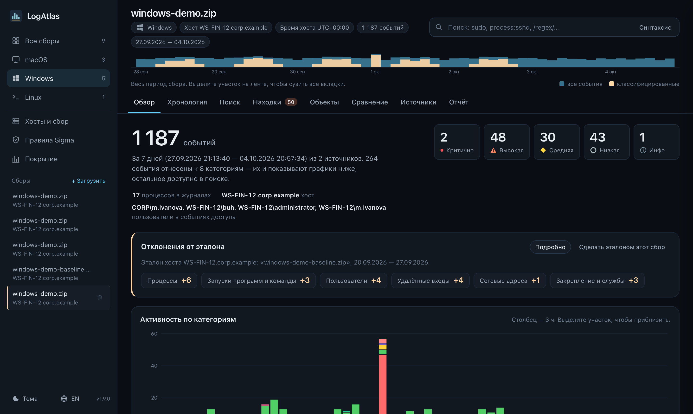
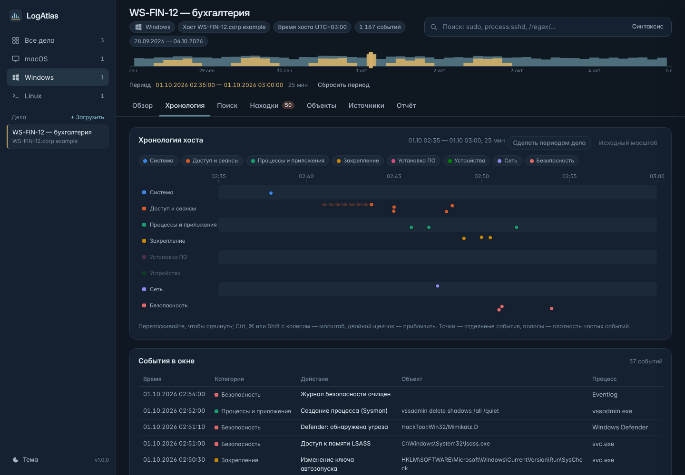
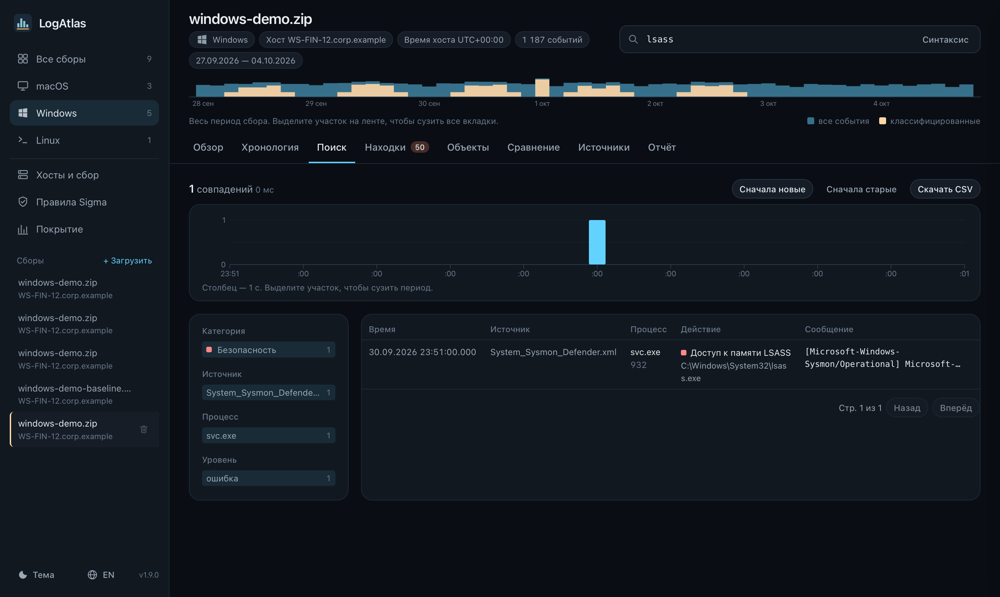
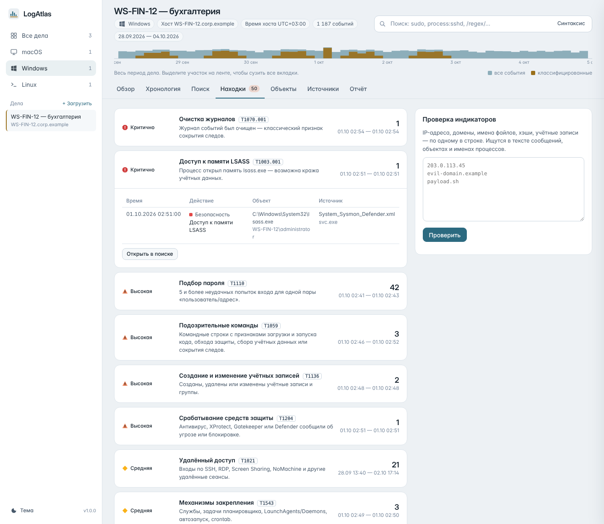
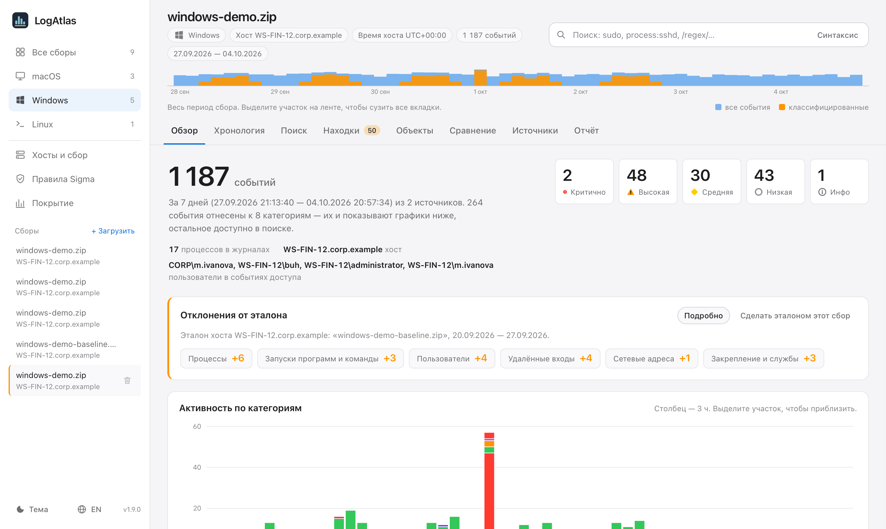
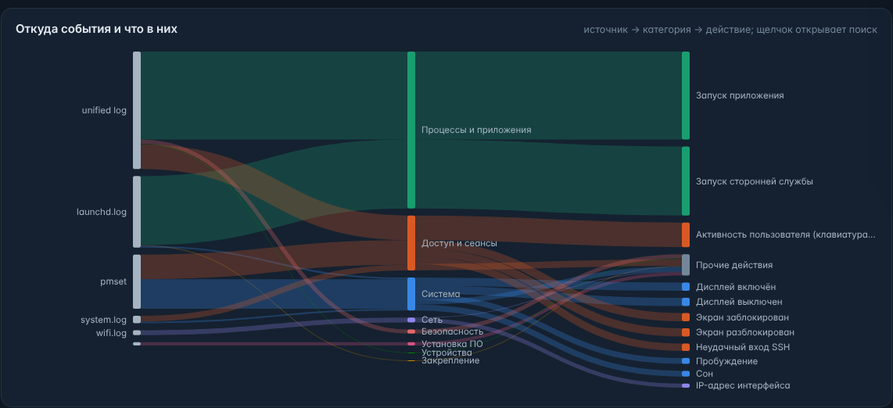
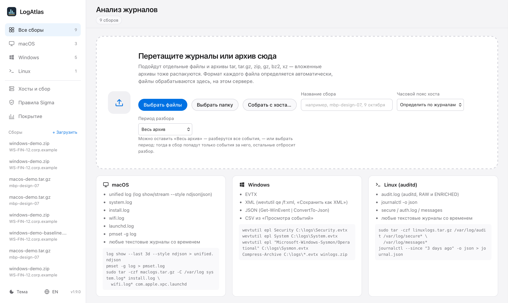
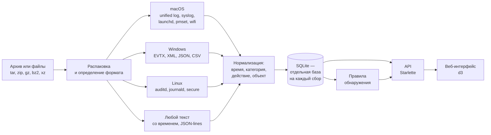

<p align="center">
  <picture>
    <source media="(prefers-color-scheme: dark)" srcset="docs/logo-dark.svg">
    
  </picture>
</p>

<p align="center">
  <b>Анализатор журналов macOS, Windows и Linux — в Docker-контейнере или как приложение для Windows и macOS.</b><br>
  Загрузи архив с логами — получишь хронологию активности на хосте, а менно: входы и удалённые сеансы,<br>
  запуски приложений, USB-носители, механизмы закрепления и находки правил обнаружения. Список можно дополнить самостоятельно, по желанию.
</p>

<p align="center">
  
  
  
  
  
  
  
  
</p>

<p align="center">
  
</p>

---

## Зачем

При разборе инцидента или проверке рабочей станции журналы обычно лежат в десятке файлов разных форматов: unified log и `pmset` на Mac, `.evtx` на Windows, `audit.log` и `journald` на Linux. LogAtlas собирает их в одну хронологию, приводит события к общему виду и сразу показывает, что на хосте происходило: кто и когда входил, что запускалось и устанавливалось, какие носители подключались, где закреплялось ПО и что из этого похоже на атаку.

Всё работает локально — на ноутбуке, сервере или Raspberry Pi. Журналы никуда не отправляются, интернет приложению не нужен.

## Возможности

| Раздел | Что умеет |
|---|---|
| **Сбор с хостов** | Из самой панели: хост, журналы, период «с … по …» и часовой пояс — Linux, macOS и Windows по SSH, ключом панели. В приложениях для Windows и macOS — ещё и журналы этого компьютера одной кнопкой. |
| **Любые архивы** | tar, tar.gz, zip, gz, bz2, xz, в том числе вложенные друг в друга. Формат каждого файла определяется автоматически. |
| **Лента времени** | Мини-гистограмма под заголовком сбора: выделите участок — и все вкладки сузятся до этого периода. |
| **Обзор** | Сводка, активность по 8 категориям, тепловая карта «день × час» с подсветкой ночи, диаграмма потоков «источник → категория → действие». |
| **Хронология** | Дорожки по категориям с масштабированием от недель до секунд. |
| **Поиск** | Подстроки, поля, шаблоны, исключения, регулярные выражения, фасеты, выгрузка в CSV, соседние события вокруг найденного. |
| **Находки** | 25 встроенных правил обнаружения с привязкой к MITRE ATT&CK, правила Sigma с загрузкой и обновлением наборов SigmaHQ прямо из интерфейса и проверка списка индикаторов (IP, домены, хэши, имена файлов). |
| **Сравнение** | Что нового в сборе по сравнению с другим сбором или с «чистым» эталоном хоста: процессы, команды, входы, службы, ПО, устройства, адреса. Отклонения от эталона видны прямо на обзоре. |
| **Объекты** | Приложения, пользователи, удалённый доступ, установленное ПО, устройства, сеть, службы и закрепление — с первым и последним появлением. |
| **Источники** | Покрытие каждого журнала по времени: видно, где сбор обрывается. |
| **Отчёт** | Печатная версия для PDF: сводка, находки, ключевые события. |
| **Оформление** | Тёмная и светлая темы, адаптивная вёрстка для телефона. |

## Скриншоты

<table>
  <tr>
    <td width="50%"><br><sub><b>Хронология.</b> 25 минут ночной атаки на Windows-станцию: подбор пароля по RDP, PowerShell, загрузка через certutil, новая служба, доступ к LSASS, очистка журнала.</sub></td>
    <td width="50%"><br><sub><b>Поиск и карточка события.</b> Сработавшие правила, все поля, исходная строка и соседние события из всех журналов.</sub></td>
  </tr>
  <tr>
    <td><br><sub><b>Находки</b> сгруппированы по важности, у каждой — техника MITRE ATT&CK и список событий.</sub></td>
    <td><br><sub><b>Linux-сервер</b> с auditd: фоновый перебор паролей из интернета виден на тепловой карте круглосуточно.</sub></td>
  </tr>
  <tr>
    <td><br><sub><b>Откуда события и что в них:</b> источник → категория → действие. Щелчок по узлу открывает поиск.</sub></td>
    <td><br><sub><b>Загрузка.</b> Файлы, папки или архивы; для больших архивов — импорт из папки на сервере.</sub></td>
  </tr>
</table>

Все скриншоты сделаны на демо-данных из `scripts/make-demo.py`: хосты, пользователи и адреса вымышлены.

## Быстрый старт

### Готовый образ

Образы для `linux/amd64` (обычные ПК и серверы) и `linux/arm64` (Raspberry Pi, серверы на ARM) публикуются в GitHub Container Registry при каждом релизе. Docker сам скачает образ под архитектуру хоста, собирать ничего не нужно.

```bash
mkdir -p logatlas/data/inbox && cd logatlas
docker run -d --name logatlas --restart unless-stopped \
  -p 8484:8484 -v "$PWD/data:/data:Z" --user "$(id -u):$(id -g)" \
  ghcr.io/arsis-02/logatlas:latest
```

Откройте `http://<адрес-сервера>:8484`. Конкретная версия — тег вместо `latest` (например, `ghcr.io/arsis-02/logatlas:1.6.0`); обновление — `docker pull` и пересоздание контейнера. Для хостов без доступа к интернету к каждому [релизу](https://github.com/ArsIS-02/logatlas/releases) приложены архивы образов: `docker load -i logatlas-<версия>-linux-amd64.tar.gz`.

То же через Docker Compose — из клона репозитория:

```bash
git clone https://github.com/ArsIS-02/logatlas.git && cd logatlas
mkdir -p data/inbox            # до первого запуска, чтобы папка принадлежала вам
docker compose pull && docker compose up -d
```

### Windows без Docker

К каждому [релизу](https://github.com/ArsIS-02/logatlas/releases) приложено оконное приложение для Windows 10 (1809 и новее) и Windows 11 — для процессоров Intel/AMD (`x64`) и ARM (`arm64`, например Snapdragon). Python встроен, ставить ничего не нужно:

| Файл | Что это |
|---|---|
| `LogAtlas-Setup-<версия>-x64.exe`, `…-arm64.exe` | установщик: ярлыки в «Пуске» и на рабочем столе, удаление через «Приложения». Можно поставить «для всех» (нужны права администратора) или «только для меня» |
| `LogAtlas-<версия>-portable-x64.zip`, `…-arm64.zip` | переносная версия: распакуйте куда угодно (хоть на флешку) и запустите `LogAtlas.exe`, данные — в папке `data` рядом |

`LogAtlas.exe` открывает **окно LogAtlas** — тот же интерфейс, но без браузера и адресной строки (окно построено на Microsoft Edge WebView2, он входит в Windows 11 и обновлённую Windows 10). Сервер работает внутри и завершается вместе с окном; если в этот момент идёт разбор, LogAtlas спросит, точно ли закрыть. Повторный запуск ярлыка поднимает уже открытое окно. Размер и положение окна запоминаются; в меню значка в заголовке окна (или `Alt+Пробел`) — «Открыть в браузере», «Папка данных», «Журнал программы», «О LogAtlas». Если WebView2 на компьютере нет, LogAtlas откроется в браузере со значком в области уведомлений.

**Журналы этого компьютера** — кнопка «Этот компьютер…» на главной странице. Windows спросит права администратора (без них журнал Security не прочитать), откроется окно сборщика с выбором журналов и периода, а готовый архив сразу уйдёт на разбор.

**Служба Windows** — чтобы панель работала без входа пользователя и открывалась с других компьютеров сети: флажок в установщике или `install-service.cmd` в переносной версии (`uninstall-service.cmd` — удалить). Служба слушает порт 8484 на всех адресах, правило брандмауэра пускает к нему только из локальной подсети (профили «Домен» и «Частная сеть»). Когда служба работает, окно LogAtlas показывает её, а не запускает второй сервер (`LogAtlas.exe --app` — своё окно со своим сервером).

| | Окно | Переносная версия | Служба |
|---|---|---|---|
| Данные | `%LOCALAPPDATA%\LogAtlas` | `data\` рядом с `LogAtlas.exe` | `%ProgramData%\LogAtlas` |
| Журнал | `logatlas.log` и `window.log` в папке данных | `data\logatlas.log` | `%ProgramData%\LogAtlas\logs` |
| Доступ | только этот компьютер | только этот компьютер | локальная сеть |

Настройки — `settings.json` в папке данных (создаётся при первом запуске): `port`, `host` (`127.0.0.1` — только этот компьютер, `0.0.0.0` — из сети) и `workers` (процессы разбора, `0` — по числу ядер). Сбор с хостов по SSH работает через встроенный в Windows клиент OpenSSH; если его нет — «Параметры → Приложения → Дополнительные компоненты → Клиент OpenSSH». Закрыть все запущенные копии: `LogAtlas.exe --quit`. При удалении собранные журналы остаются в папке данных — удалите её, если они больше не нужны.

Установщик и `LogAtlas.exe` не подписаны сертификатом разработчика, поэтому при первом запуске Windows SmartScreen может показать «Windows защитила ваш компьютер» — «Подробнее» → «Выполнить в любом случае».

Собрать самому — на Windows нужной архитектуры с Python 3.12 той же архитектуры, Visual Studio Build Tools (C++) и Inno Setup 6: `powershell -ExecutionPolicy Bypass -File windows\build.ps1` (результат — в `dist\`). То же делает workflow [`windows.yml`](.github/workflows/windows.yml) на каждом изменении для x64 и ARM64, проверяя на чистой Windows переносную версию с окном, установку со службой, окно рядом со службой и удаление; готовые файлы лежат в артефактах запуска.

### macOS без Docker

К каждому [релизу](https://github.com/ArsIS-02/logatlas/releases) приложено оконное приложение для macOS 12 и новее: `LogAtlas-<версия>-macos-arm64.dmg` — для Mac на Apple Silicon (M1–M4), `LogAtlas-<версия>-macos-x86_64.dmg` — для Mac на Intel. Откройте образ и перетащите LogAtlas в «Программы». Python встроен, ставить ничего не нужно.

Окно показывает тот же интерфейс, что и в браузере (WebKit входит в macOS); сервер работает внутри и завершается вместе с программой, а если в этот момент идёт разбор — LogAtlas спросит, точно ли закрыть. В меню — «Открыть в браузере», «Папка данных», «Журнал программы», масштаб (`⌘+`, `⌘−`, `⌘0`) и печать отчёта (`⌘P`); выгрузки CSV и скрипты подготовки хостов сохраняются в «Загрузки». Данные и журнал (`logatlas.log`, `window.log`) — в `~/Library/Application Support/LogAtlas`, настройки — в `settings.json` там же (как на Windows). Сбор с хостов по SSH работает через встроенный в macOS `ssh`.

**Журналы этого Mac** — кнопка «Этот Mac…» на главной странице или «Файл → Собрать журналы этого Mac…»: выберите период (от суток до 30 дней), macOS попросит пароль администратора в своём окне (LogAtlas его не видит), и сборщик `collect-macos.sh` выгрузит unified log без самых шумных подсистем, журнал питания и установок — архив сразу уйдёт на разбор.

Приложение не заверено у Apple (это платная подпись разработчика), поэтому при первом запуске macOS скажет, что не может проверить разработчика. Откройте «Системные настройки → Конфиденциальность и безопасность» и нажмите «Всё равно открыть» (на macOS 14 и старше достаточно щёлкнуть по LogAtlas правой кнопкой → «Открыть»). То же одной командой: `xattr -dr com.apple.quarantine /Applications/LogAtlas.app`.

Собрать самому — на Mac нужной архитектуры с Xcode Command Line Tools: `bash macos/build.sh` (результат — в `dist/`). То же делает workflow [`macos.yml`](.github/workflows/macos.yml) на каждом изменении для Apple Silicon и Intel, проверяя образ диска, разбор демо-журналов сервером приложения и открытие интерфейса в окне; готовые файлы лежат в артефактах запуска.

### Сборка из исходников

```bash
git clone https://github.com/ArsIS-02/logatlas.git && cd logatlas
mkdir -p data/inbox
docker compose up -d --build
```

Первая сборка занимает несколько минут: скачивается `python:3.12-slim` под архитектуру хоста (arm64 или amd64).

### Попробовать без своих журналов

В папке [`demo/`](demo) лежат `macos-demo.tar.gz`, `windows-demo.zip` и `linux-demo.tar.gz` — неделя обычной работы трёх вымышленных хостов со встроенным сценарием атаки в каждом. Загрузите их на главной странице. Пересоздать архивы: `python3 scripts/make-demo.py demo`.

Рядом — `*-demo-baseline.*`: «чистая» предыдущая неделя тех же хостов без атаки. Загрузите её, нажмите на обзоре «Сделать этот сбор эталоном», затем загрузите основной демо-архив — на его обзоре появятся отклонения от эталона, а на вкладке «Сравнение» — новые процессы, входы с чужого адреса, службы и задачи атакующего. Пересоздать: `python3 scripts/make-demo.py demo --baseline`.

### Raspberry Pi и РЕД ОС

Рассчитано на Raspberry Pi 5 (16 ГБ) с РЕД ОС 8 aarch64 и Docker 29. На RHEL-подобных системах с SELinux том уже подключён с меткой `:Z`; порт нужно открыть в firewalld:

```bash
sudo firewall-cmd --add-port=8484/tcp --permanent && sudo firewall-cmd --reload
```

Если ваш UID не 1000, задайте его в `.env` рядом с `docker-compose.yml`: `printf 'LOGATLAS_UID=%s\nLOGATLAS_GID=%s\n' "$(id -u)" "$(id -g)" > .env` — файлы в `./data` будут принадлежать вам. Порт меняется переменной `LOGATLAS_PORT`.

## Как собрать журналы

В `scripts/` лежат готовые скрипты сбора. Каждый создаёт один архив, который загружается в LogAtlas как есть.

| ОС | Команда | Что собирает |
|---|---|---|
| macOS | `sudo bash collect-macos.sh 3` | unified log за N дней (без самых шумных подсистем), `pmset -g log`, `system.log`, `install.log`, `wifi.log`, `launchd.log` |
| Linux | `sudo bash collect-linux.sh` | диалог: какие журналы (journald, auditd, secure/auth.log, syslog, cron, пакеты, fail2ban, веб-серверы, входы из wtmp/btmp, Wazuh) и за какой период по часам хоста; архив можно сразу отправить в LogAtlas. `sudo bash collect-linux.sh 3` — без вопросов, за 3 дня |
| Windows | `powershell -ExecutionPolicy Bypass -File collect-windows.ps1` | Security, System, Application, Sysmon, PowerShell, Defender, планировщик, RDP — в `.evtx` |
| Windows, с окном | двойной щелчок по `collect-windows-gui.cmd` | то же, с выбором журналов и периода (24 часа, 3, 7, 30 дней, всё время или свои даты «с … по …»), ходом сбора и подсказкой, что делать с архивом |

`collect-windows-gui.cmd` — самодостаточный файл: его можно положить на рабочий стол и запускать двойным щелчком. Он запросит права администратора, покажет, какие журналы есть на компьютере и куда сохранится архив, ход выгрузки и что делать дальше. Адрес LogAtlas для кнопки «Открыть» задаётся в строке `set "LOGATLAS_URL="` в начале файла или прямо в окне — он запоминается.

В [LogAtlas для Windows](#windows-без-docker) то же окно открывается кнопкой «Этот компьютер…» на главной странице — архив не нужно загружать вручную, он сразу уходит на разбор.

### Сбор с хостов из панели

Раздел **«Хосты и сбор»** в боковой панели.

1. **Подготовить хост — один раз.** Панель показывает команду для каждой ОС, её достаточно выполнить на хосте:

   | Хост | Где выполнить | Команда |
   |---|---|---|
   | Linux, macOS | терминал, пользователь с `sudo` | `curl -fsSL http://<панель>:8484/setup/host.sh \| sudo bash` |
   | Windows 10/11 | PowerShell от имени администратора, в папке со скачанным `logatlas-setup.ps1` (ссылка в панели) | `powershell -ExecutionPolicy Bypass -File .\logatlas-setup.ps1` |

   На Linux и macOS скрипт создаёт системного пользователя `logatlas-collect`, кладёт ему ключ панели и ставит скрипт сбора (см. «Безопасность»); на macOS нужно заранее включить «Удалённый вход». На Windows скрипт включает встроенный OpenSSH Server и добавляет ключ панели к вашей учётной записи — с теми же ограничениями, новых пользователей не создаёт; в карточке хоста укажите эту учётную запись. Отдельный пользователь `logatlas-collect` на Windows — параметр `-CreateUser`. Убрать всё с хоста — команды под спойлером «Убрать с хоста» в панели.
2. **Добавить хост:** «+ Хост» — адрес (имя или IP), порт SSH, система. «Проверить» подключается и показывает, сколько журналов найдено и часовой пояс хоста.
3. **Собрать:** «Собрать…» — панель подключается и показывает найденные журналы с размером и датами первой и последней записи. Отметьте нужные, выберите период (24 часа, 3, 7, 30 дней или свои «с … по …») и часовой пояс — по умолчанию пояс хоста; в нём задаётся период и показывается сбор. «Собрать» — хост отбирает записи за период, архив приходит в панель по SSH и сразу разбирается; ход виден на странице сбора.

Журналы, которые находит скрипт: Linux — journald, auditd, secure/auth.log, syslog, cron, пакеты, ядро, почта, fail2ban, firewalld, nginx/Apache, входы из wtmp/btmp, Wazuh; macOS — unified log (с фильтром шума и полностью), питание, install.log, system.log, Wi-Fi, launchd; Windows — Security, System, Application, Sysmon, PowerShell, Defender, планировщик, RDP.

### Сбор с Linux-хостов по SSH со своего компьютера

Без подготовки хоста, под своим пользователем SSH:

| Откуда | Запуск |
|---|---|
| Windows | двойной щелчок по `scripts/collect-linux-remote.cmd` |
| macOS, Linux | `bash scripts/collect-linux-remote.sh` |

Скрипт спросит адрес LogAtlas, хост (из файла hosts — с отметкой, кто отвечает на ping — или имя/адрес вручную) и пользователя SSH с правом `sudo`. `collect-linux.sh` передаётся на хост внутри той же SSH-команды, на хосте ничего не устанавливается. Дальше — диалог `collect-linux.sh`: список найденных журналов с размером и датами первой и последней записи, выбор журналов и периода «с … по …» по часам хоста. Хост упаковывает архив и сам отправляет его в LogAtlas с часовым поясом хоста; если до LogAtlas с хоста не достучаться, архив скачивается на ваш компьютер и отправляется оттуда. Пароли не сохраняются; адрес LogAtlas и пользователь для каждого хоста запоминаются (`%APPDATA%\LogAtlas\linux-remote.json`, `~/.config/logatlas/linux-remote.conf`).

Архивы в несколько гигабайт удобнее скопировать в `data/inbox` на сервере и импортировать из раздела «Большие архивы».

## Поддерживаемые форматы

| Платформа | Форматы |
|---|---|
| **macOS** | unified log (`log show` / `log stream --style ndjson` или `json`), `system.log`, `install.log`, `wifi.log`, `launchd.log`, `pmset -g log` |
| **Windows** | `.evtx`, XML (`wevtutil qe /f:xml`, «Сохранить как XML»), JSON (`Get-WinEvent \| ConvertTo-Json`), CSV из «Просмотра событий» на русском и английском |
| **Linux** | `audit.log` (RAW и ENRICHED), `journalctl -o json`, `secure`, `auth.log`, `messages` |
| **Любые** | текстовые журналы со временем в строке (ISO 8601, syslog, ctime, `[YYYY-MM-DD HH:MM:SS]`, epoch) и JSON-lines — попадают в поиск и хронологию без классификации |

Время показывается по часам исследуемого хоста. Часовой пояс определяется по журналам, где есть смещение (unified log, pmset), или задаётся при загрузке.

## Правила обнаружения

| Важность | Правило | MITRE ATT&CK |
|---|---|---|
| 🔴 Критично | Очистка журналов | T1070.001 |
| 🔴 Критично | Доступ к памяти LSASS | T1003.001 |
| 🔴 Критично | Защита антивируса отключена | T1562.001 |
| 🟠 Высокая | Срабатывание средств защиты (антивирус, XProtect, Gatekeeper, Defender) | T1204 |
| 🟠 Высокая | Подозрительные команды: загрузка и запуск кода, обход защиты, сбор учётных данных, сокрытие следов | T1059 |
| 🟠 Высокая | Подозрительный PowerShell | T1059.001 |
| 🟠 Высокая | Вмешательство в аудит | T1562.012 |
| 🟠 Высокая | Создание и изменение учётных записей | T1136 |
| 🟠 Высокая | Подбор пароля (5 и более ошибок для пары «пользователь/адрес») | T1110 |
| 🟡 Средняя | Удалённый доступ: SSH, RDP, Screen Sharing, NoMachine | T1021 |
| 🟡 Средняя | Механизмы закрепления: службы, задачи, LaunchAgents/Daemons, ключи Run, cron | T1543 |
| 🟡 Средняя | Внешние носители и USB | T1091 |
| 🟡 Средняя | Доступ к камере, микрофону, экрану, вводу (TCC) | T1123 |
| 🟡 Средняя | Установка ПО из «Загрузок» и временных папок | T1204.002 |
| 🟡 Средняя | Модули ядра | T1547.006 |
| 🟡 Средняя | Изменение системного времени | T1070.006 |
| 🟡 Средняя | Активность ночью (00:00–05:59) | — |
| ⚪ Низкая | Ошибки аутентификации, sudo/su, запреты SELinux/AppArmor, циклические падения служб, обрыв плотного журнала | — |
| ℹ️ Инфо | Установленное ПО, загрузки и выключения, сбои приложений | — |

Правила описаны в [`app/detections.py`](app/detections.py) как SQL-условия по нормализованным полям — новое правило добавляется одной строкой.

### Правила Sigma

Раздел «Правила Sigma» в боковой панели загружает готовые наборы правил [Sigma](https://sigmahq.io) прямо из репозитория [SigmaHQ](https://github.com/SigmaHQ/sigma): выберите набор и нажмите «Загрузить», позже — «Проверить обновления». LogAtlas скачивает пакет последнего релиза SigmaHQ (или архив основной ветки), показывает его версию и дату и обновляет набор: новые правила добавляются, изменённые обновляются, убранные из SigmaHQ удаляются. Выключенные вами правила остаются выключенными, правила, импортированные файлами, не трогаются. После загрузки уже разобранные сборы сразу проверяются новыми правилами (флажок можно снять).

| Набор | Что входит |
|---|---|
| Core | проверенные правила (`test`, `stable`) высокого и критичного уровня — мало ложных срабатываний |
| Core+ (по умолчанию) | то же и правила среднего уровня — больше охват, нужен разбор срабатываний |
| Core++ | Core+ и экспериментальные правила |
| Все правила | Core++ и правила новых угроз (Emerging Threats) |
| Основная ветка | самые свежие правила из `rules`, `rules-emerging-threats` и `rules-threat-hunting`, ещё не вошедшие в релиз |

Нужен доступ к `github.com` (с сервера или компьютера, где работает LogAtlas; переменные `HTTPS_PROXY` / `NO_PROXY` учитываются, для Docker их можно задать в `.env` рядом с `docker-compose.yml`, свой корневой сертификат прокси задаёт `SSL_CERT_FILE`). Без интернета скачайте пакет, например `sigma_core+.zip` из [релизов SigmaHQ](https://github.com/SigmaHQ/sigma/releases), на другом компьютере и импортируйте его файлом — раздел принимает и свои правила `.yml`, и архивы `.zip` с ними. Переменная `LOGATLAS_SIGMA_UPSTREAM` указывает зеркало репозитория вместо GitHub, `LOGATLAS_SIGMA_UPDATE=0` отключает загрузку из сети.

Новые сборы проверяются включёнными правилами сразу после разбора, уже разобранные — кнопкой «Применить ко всем сборам». Срабатывания появляются на вкладке «Находки» с меткой Sigma и техникой MITRE ATT&CK из тегов правила.

| | |
|---|---|
| Журналы | Windows: Sysmon (все категории — создание процессов, сеть, реестр, файлы, загрузка библиотек, доступ к процессам, DNS, каналы…), Security, System, Application, PowerShell (4103/4104), Defender, планировщик, RDP и другие каналы. Linux: auditd, auth/secure, sshd, sudo, cron, создание процессов. macOS: создание процессов (команды sudo и запуски) |
| Поля | из EventData Windows и записей auditd «поле=значение», плюс нормализованные поля LogAtlas: `Image`, `CommandLine`, `User`, `EventID`, `Provider_Name`, `Channel`, `Computer` и т. п. |
| Модификаторы | `contains`, `startswith`, `endswith`, `all`, `re` (с `i`/`m`/`s`), `cidr`, `exists`, `gt`/`gte`/`lt`/`lte`, `cased`, `base64`, `base64offset`, `wide`, `windash`, шаблоны `*` и `?` |
| Условия | `and`, `or`, `not`, скобки, `1 of …`, `all of …`, `… of them`, несколько условий списком |
| Не применяются | агрегации (`| count()`, `timeframe`), корреляции, `fieldref`, `expand`, журналы облаков, сетевых устройств и веб-серверов — такие правила видны в списке с причиной |

Правила хранятся в каталоге (`data/catalog.db`), их можно включать, выключать и удалять по одному или выбором. Весь набор SigmaHQ (около 3 000 правил, из них применимы ~2 700) проверяет небольшой сбор за секунду-две, сбор на сотни тысяч событий — за десятки секунд: кандидатов отбирает SQLite (журнал, EventID, обязательные подстроки, на больших сборах — индекс триграмм FTS5), а точную проверку полей делает Python.

## Сравнение сборов и эталон хоста

Вкладка «Сравнение» показывает, что в сборе нового по сравнению с другим сбором: процессы, запуски программ и команды, пользователи, удалённые входы, установленное ПО, устройства, сетевые адреса и механизмы закрепления — «новое», «пропало» и «заметно чаще» (в 10 и более раз чаще в сутки). Номера, GUID и регистр в именах не учитываются, адреса своих сетевых интерфейсов не считаются отклонением. Щелчок по строке открывает её события в поиске.

**Эталон хоста** — «чистый» сбор, с которым автоматически сравниваются следующие сборы того же хоста (имя хоста без домена, без учёта регистра). Отметить — кнопкой «Сделать этот сбор эталоном» на вкладке «Обзор» или «Сравнение». На обзоре каждого следующего сбора появляется панель «Отклонения от эталона» со счётчиками по видам объектов.

## Синтаксис поиска

| Запрос | Что делает |
|---|---|
| `sudo` | подстрока в сообщении, имени процесса или объекте |
| `"screen sharing"` | фраза целиком |
| `process:sshd` | точное значение поля: `process`, `source`, `user`, `host`, `level`, `code`, `pid` |
| `process:kav*` | шаблон |
| `process:sudo\|sshd` | несколько значений |
| `cat:доступ` | категория: система, доступ, процессы, закрепление, по, устройства, сеть, безопасность |
| `action:вход` · `subject:…` · `msg:…` | подстрока в действии, объекте, сообщении |
| `level:warning+` | уровень и выше |
| `-process:mdworker` | исключить |
| `/fail(ed\|ure)/` | регулярное выражение |
| `rule:remote_access` | события конкретной находки |

Условия объединяются через «И». Клавиша <kbd>/</kbd> переводит фокус в строку поиска.

## Как это устроено



- **Бэкенд** — Python 3.12, Starlette, Uvicorn, SQLite. Никаких внешних баз и очередей.
- **Фронтенд** — без сборки: ES-модули, d3 и d3-sankey, шрифты Inter и DejaVu Sans Mono лежат в репозитории.
- **Хранение** — каталог сборов в `data/catalog.db`, события каждого сбора в `data/cases/<id>.db`. Удаление сбора мгновенно освобождает место. Хосты — `data/hosts.json`, ключ панели — `data/keys/`, отпечатки хостов — `data/known_hosts`.
- **Скорость** — разбор идёт параллельно на всех ядрах сервера: архив раскладывается на независимые части (члены архива, куски больших построчных журналов), каждый процесс пишет события в свою временную базу, а в базу сбора они копируются одним проходом сразу с часовым поясом. Сборщики на хостах тоже работают параллельно: `log show` и `journalctl` выгружают отрезки периода одновременно, журналы Windows — все сразу, каждая часть сжимается `gzip -1`. Число процессов разбора задаёт переменная `LOGATLAS_WORKERS` (по умолчанию — число ядер). Поиск по подстроке занимает доли секунды, сводка «Обзора» хранится в базе сбора и открывается сразу.

<details>
<summary><b>Структура проекта</b></summary>

```
logatlas/
├── app/
│   ├── main.py            маршруты API и раздача интерфейса
│   ├── ingest.py          распаковка архивов, очередь обработки
│   ├── detections.py      правила обнаружения
│   ├── analytics.py       запросы для дашбордов, хронологии, поиска
│   ├── search.py          язык запросов → SQL
│   └── parsers/           macOS, Windows, Linux, syslog, универсальные
├── static/                интерфейс: HTML, CSS, ES-модули, d3, шрифты
├── scripts/               сбор журналов и генератор демо-данных
├── docs/                  логотип и скриншоты
├── Dockerfile
└── docker-compose.yml
```
</details>

## Обслуживание

| Задача | Команда |
|---|---|
| Журнал контейнера | `docker compose logs -f logatlas` |
| Журнал на Windows | `%LOCALAPPDATA%\LogAtlas\logatlas.log` (служба — `%ProgramData%\LogAtlas\logs`) |
| Обновить | `git pull && docker compose up -d --build` |
| Остановить | `docker compose down` |
| Резервная копия всех сборов и ключа панели | `tar -czf logatlas-data.tar.gz data` (на Windows — скопируйте папку данных) |
| Обновить на Windows | запустить установщик новой версии поверх старой: данные и служба сохранятся |

**Удаление сборов.** Наведите курсор на сбор в боковой панели → значок корзины → «Удалить?» → щёлкнуть ещё раз. Несколько сразу — на главной странице («Все сборы» или платформа): отметьте флажки или «Выбрать все» → «Удалить выбранные» → подтвердить вторым щелчком. Удаляются события сбора и его файлы; исходные архивы в `data/inbox` не трогаются. Сбор, который сейчас разбирается, удалить нельзя — дождитесь окончания; идущий сбор с хоста удаление останавливает.

## Безопасность

Входа по паролю нет: инструмент рассчитан на одного аналитика в доверенной сети. Не публикуйте порт 8484 в интернет — для доступа извне поставьте перед ним reverse-proxy с авторизацией или используйте VPN. Приложение для Windows по умолчанию открыто только на этом компьютере (`127.0.0.1`); служба Windows — для локальной подсети.

Сбор с хостов устроен так, чтобы панель не могла сделать на хосте ничего, кроме чтения журналов:

| Мера | Зачем |
|---|---|
| Отдельный пользователь `logatlas-collect` без пароля (на Windows по умолчанию — ваша учётная запись, ключ с принудительной командой; с `-CreateUser` — отдельный пользователь без прав администратора, в группе «Читатели журнала событий») | вход только по ключу панели |
| `authorized_keys` принадлежит root (на Windows — администраторам), ключ с `restrict,from="<адрес панели>,172.16.0.0/12,127.0.0.1"` | ключ бесполезен с других адресов; без терминала и переадресаций; `172.16.0.0/12` — сеть Docker |
| Принудительная команда `logatlas-ssh` (на Windows — `command=` у ключа или `ForceCommand` в `sshd_config`) | пропускает только `version`, `scan` и `collect <эпоха> <эпоха> <журналы>` с проверкой каждого аргумента |
| `sudo` только на `/usr/local/libexec/logatlas/collect.sh` | никаких других команд от root |
| Ключ панели — в `data/keys/` (на Windows — в `keys\` папки данных, доступ только у владельца, SYSTEM и администраторов) | не копируйте его; если утёк — удалите `data/keys/*`, перезапустите контейнер (появится новый ключ) и повторите подготовку хостов |

Скрипт подготовки хоста отдаётся панелью по HTTP без авторизации и содержит только открытый ключ — его можно смело открыть и прочитать перед запуском.

## Планы

- [ ] Вход по паролю для нескольких аналитиков
- [x] Готовый образ в GitHub Container Registry (`docker pull` без сборки)
- [x] Оконное приложение и служба для Windows x64 и ARM64 без Docker
- [x] Оконное приложение для macOS (Apple Silicon и Intel)
- [x] Импорт правил Sigma и обновление наборов SigmaHQ из интерфейса
- [x] Сравнение двух сборов и базовой линии хоста
- [ ] Разбор `.logarchive` и sysdiagnose напрямую

## Лицензия

[MIT](LICENSE). Сторонние компоненты и их лицензии перечислены в [THIRD_PARTY.txt](THIRD_PARTY.txt).
